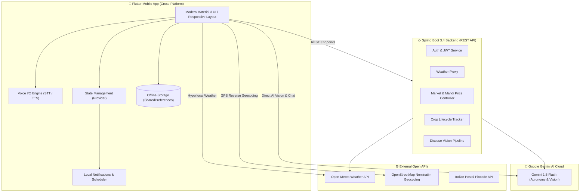

# 🌾 FarmWise — AI-Powered Smart Agriculture & Farmer Guidance System

[](https://flutter.dev)
[](https://spring.io/projects/spring-boot)
[](https://www.oracle.com/java/)
[](https://ai.google.dev/)
[](LICENSE)
[](CONTRIBUTING.md)

**FarmWise** is an offline-first, multilingual, AI-driven smart agriculture mobile platform designed to empower farmers across India and worldwide. Powered by **Google Gemini 1.5 Flash AI** and built with a modern **Flutter mobile frontend** and **Java Spring Boot backend**, FarmWise delivers real-time agronomic guidance, camera-based crop disease diagnosis, daily live APMC mandi market commodity prices, hyperlocal meteorological forecasts, and voice-assisted interaction in **23 Indian regional languages**.

---

## 🌟 Key Highlights & Features

### 🤖 1. AI Plant Pathologist & Disease Vision Scanner
- **Instant Camera & Gallery Leaf Diagnosis:** Point the phone camera at any diseased leaf, stem, or crop.
- **Multimodal Computer Vision:** Powered by Gemini 1.5 Flash Vision to identify pathogens (fungal, bacterial, viral, nutrient deficiencies).
- **Comprehensive Treatment Plan:** Delivers organic biological remedies (Neem oil, Trichoderma) and safe chemical controls, confidence scores, and containment steps.
- **Offline Fallback Engine:** Built-in offline diagnostic rules ensure farmers can diagnose common crop issues even without cellular network.

### 🌱 2. Personalized Agronomic Crop Advisory
- **Hyperlocal Precision:** Suggests optimal crops based on real-time soil type (Black, Red, Alluvial, Clay, Laterite), seasonal calendar (Kharif, Rabi, Zaid), water availability, and farm coordinates.
- **Field Action Guides:** Actionable NPK fertilizer schedules, irrigation water requirements, and estimated harvest yield per hectare.

### 📈 3. Live APMC Mandi Market Commodity Rates
- **Daily Price Bulletins:** Real-time commodity mandi rates across major Indian APMC markets (Azadpur, Koyambedu, Vashi, Lasalgaon, etc.).
- **Smart Filtering:** Browse across categories: *Crops & Grains*, *Vegetables*, *Fruits*, and *Spices & Cash Crops*.
- **Multilingual Search:** Search by English or regional language crop names (e.g. Wheat, Gehu, கோதுமை).

### 🌦️ 4. Hyperlocal Meteorological Intelligence
- **High-Accuracy Weather:** Integration with Open-Meteo & OpenWeatherMap providing current temperature, humidity, wind speed, and precipitation chance.
- **Precipitation Prediction:** Alerts farmers to expected rain arrival times and offers a 7-day extended agricultural forecast.

### 💰 5. Farm Finance & Profit/Loss Ledger
- **Offline Farm Accounting:** Track all agricultural income (crop harvests, livestock sales) and expenses (seeds, fertilizer, diesel, labor).
- **Visual Analytics:** Interactive revenue-expense breakdown charts (`fl_chart`) and net profit calculations.
- **Local Privacy:** Stored offline on-device with zero cloud lock-in.

### 📅 6. Crop Calendar & Recurring Task Scheduler
- **Interactive Crop Timeline:** Full crop batch season planning with `table_calendar`.
- **Automated Irrigation Generator:** Create recurring irrigation schedules (e.g. every 2 days) and track daily field tasks.
- **Smart Local Notifications:** Morning 10:00 AM push notification summaries for pending daily farm tasks.

### 🗣️ 7. Multilingual Voice Assistant (23 Languages)
- **Voice-First Design:** Full Speech-to-Text (STT) and Text-to-Speech (TTS) integration using `speech_to_text` and `flutter_tts`.
- **23 Official Indian Languages Supported:**
  *Hindi, Tamil, Telugu, Kannada, Malayalam, Marathi, Gujarati, Bengali, Punjabi, Odia, Assamese, Urdu, Sanskrit, Konkani, Manipuri, Bodo, Dogri, Kashmiri, Maithili, Nepali, Santali, Sindhi, and English.*

---

## 🏗️ Architecture & System Design



---

## 📂 Project Structure

```
mobile.app/
├── frontend/                     # Flutter Mobile Application
│   ├── lib/
│   │   ├── l10n/                 # 23 Indian language dictionaries & translation mappings
│   │   ├── providers/            # State management (Location, Navigation, Language, Auth)
│   │   ├── screens/              # 16 Feature screens (Dashboard, Market, Disease, Weather, etc.)
│   │   ├── services/             # AI (Gemini), Voice (TTS/STT), Notifications, Schedulers
│   │   ├── widgets/              # Reusable UI components & location pickers
│   │   ├── main.dart             # App entry point & lifecycle observer
│   │   └── theme.dart            # FarmWise Emerald Green Material 3 theme
│   ├── assets/images/            # App icons, crop illustrations & logos
│   └── pubspec.yaml              # Dependencies and asset declarations
│
├── backend-java/                 # Spring Boot Microservice API
│   ├── src/main/java/com/smartfarmer/
│   │   ├── config/               # CORS and security configurations
│   │   ├── controller/           # REST Controllers (Auth, AI, Disease, Finance, Market, etc.)
│   │   ├── model/                # User and Transaction data models
│   │   ├── service/              # Gemini AI client & JWT token services
│   │   └── SmartFarmerApplication.java
│   └── pom.xml                   # Maven build configuration
│
└── .gitignore                    # Comprehensive ignore rules for Flutter & Spring Boot
```

---

## 🚀 Getting Started

### Prerequisites
- **Flutter SDK**: 3.24.0 or higher
- **Java Development Kit (JDK)**: Java 17 or higher
- **Android Studio / VS Code**: with Flutter and Dart extensions
- **Google Gemini API Key**: from [Google AI Studio](https://aistudio.google.com/)

---

### Running the Flutter Mobile App

1. Navigate to the frontend directory:
   ```bash
   cd frontend
   ```

2. Install dependencies:
   ```bash
   flutter pub get
   ```

3. Launch on a connected device, emulator, or Chrome:
   ```bash
   flutter run
   ```

---

### Running the Java Spring Boot Backend

1. Navigate to the backend directory:
   ```bash
   cd backend-java
   ```

2. Configure environment variables in `.env` or `application.properties`:
   ```properties
   server.port=5000
   gemini.api.key=YOUR_GEMINI_API_KEY
   jwt.secret=YOUR_SECURE_256BIT_SECRET
   ```

3. Run with Maven Wrapper:
   ```bash
   # Windows PowerShell
   $env:JAVA_HOME = "C:\Program Files\Java\jdk-27"   # or your JDK path
   .\mvnw.cmd spring-boot:run

   # macOS / Linux
   ./mvnw spring-boot:run
   ```

The backend starts at `http://localhost:5000`. Test the health check endpoint:
```bash
curl http://localhost:5000/api/health
```

---

## 🛡️ Privacy & Offline First

FarmWise is built with an **offline-first philosophy**. Farm financial ledgers, crop planning calendars, profile details, and cached agricultural advisory data reside directly on the farmer's device. No unnecessary personal data is transmitted without explicit action.

---

## 🤝 Contributing

Contributions are welcome! Please feel free to submit a Pull Request or open an Issue.

1. Fork the Repository
2. Create your Feature Branch (`git checkout -b feature/AmazingFeature`)
3. Commit your Changes (`git commit -m 'Add some AmazingFeature'`)
4. Push to the Branch (`git push origin feature/AmazingFeature`)
5. Open a Pull Request

---

## 📄 License

This project is licensed under the MIT License — see the [LICENSE](LICENSE) file for details.

---

<p align="center">
  Crafted with ❤️ for farmers worldwide by <a href="https://github.com/nava-07"><b>nava-07</b></a>
</p>
